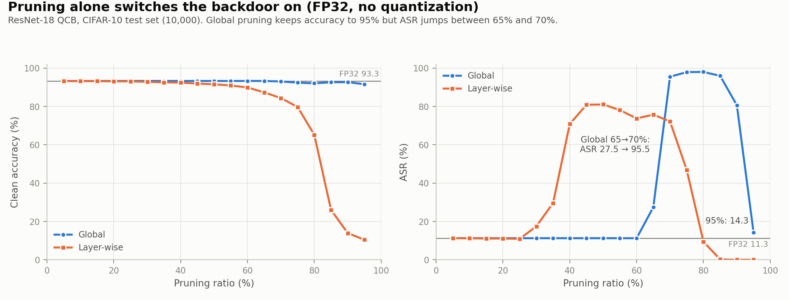
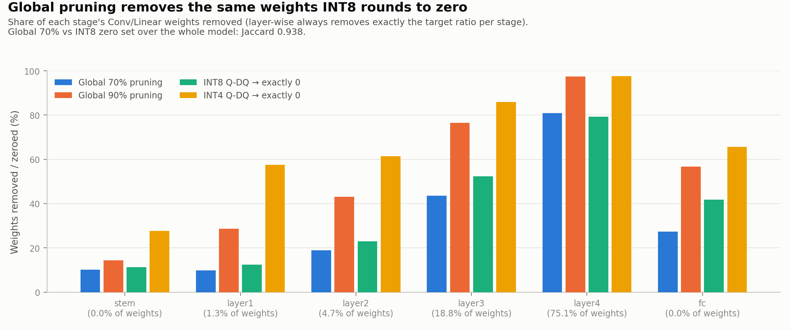
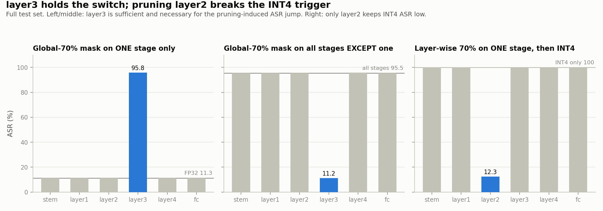
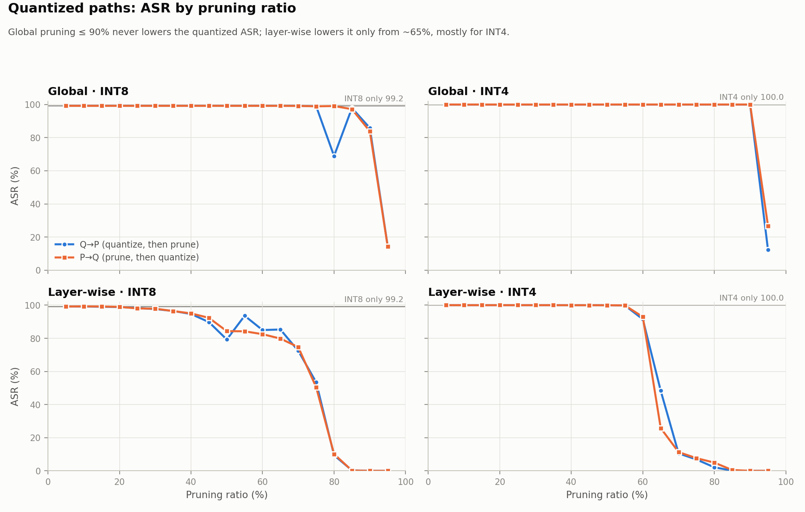
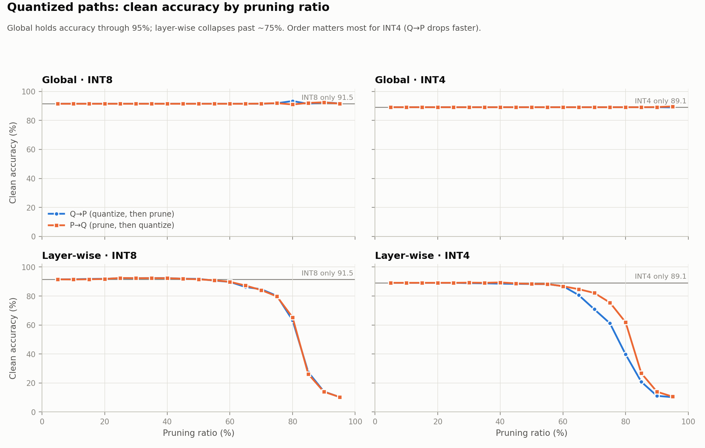
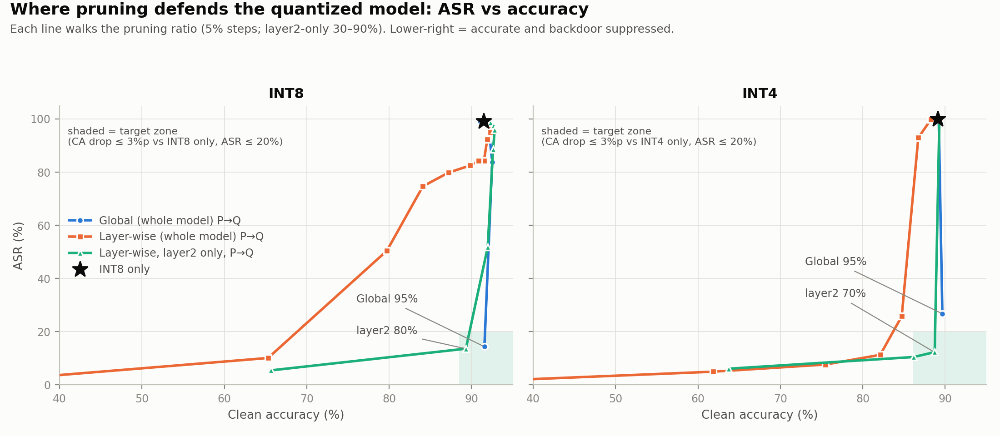
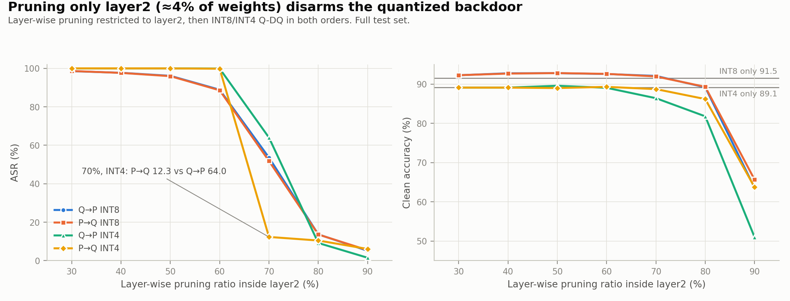

# ResNet-18 분석 리포트: 프루닝이 QCB 백도어에 미치는 영향

- 담당: 최상윤 (ResNet-18)
- 작성일: 2026-11-17
- 기준 코드: `main` `41f8579` + 분석 코드 `analysis/resnet18/` (로컬 브랜치 `analysis/resnet18`)
- 환경: WSL2 Ubuntu 24.04, RTX 5070 Ti, Python 3.12.3, torch 2.7.1+cu128

---

## 요약

1. **양자화 없이 프루닝만 해도 백도어가 켜집니다.** Global 프루닝 비율이 65%에서 70%로 넘어가면 ASR이 27.5%에서 95.5%로 급등합니다. 이때 CA는 93.0%로 거의 그대로입니다.
2. **원인은 "작은 가중치를 0으로 만드는 효과"입니다.** Global 70% 프루닝이 지우는 가중치와 INT8 양자화가 0으로 만드는 가중치는 Jaccard 0.938로 거의 같은 집합입니다.
3. **백도어를 켜는 위치는 layer3입니다.** Global 70% 마스크를 layer3에만 적용해도 ASR이 95.8%가 되고, layer3만 빼고 적용하면 ASR은 11.2%로 그대로입니다.
4. **layer2만 프루닝하면 양자화 백도어를 막을 수 있습니다.** layer2를 layer-wise 70%로 자른 뒤 INT4로 양자화하면 CA 88.7%, ASR 12.3%입니다(INT4만 했을 때 89.1% / 100%).
5. **처리 순서가 결과를 바꿉니다.** 같은 layer2 70%·INT4 조건에서 P→Q는 ASR 12.3%, Q→P는 ASR 64.0%입니다.
6. **전체 모델 기준으로는 Global 95%가 가장 좋은 방어 조건입니다.** INT8에서 CA 91.6% / ASR 14.3%, INT4(Q→P)에서 CA 89.0% / ASR 12.2%입니다.

---

## 1. 실험 설정

| 항목 | 내용 |
|---|---|
| 모델 | Qu-ANTI-zation(NeurIPS 2021) 공개 QCB ResNet-18 체크포인트 (SHA-256 검증) |
| 데이터 | CIFAR-10 테스트셋 10,000장. 트리거: 이미지 오른쪽 아래 4×4 영역을 최대 밝기로. target class 0 |
| 지표 | CA = 정상 이미지 정답률, ASR = 트리거 이미지가 class 0으로 분류된 비율 (ASR-all) |
| 양자화 | 공통 `quantize()`로 weight를 INT8·INT4 Q-DQ (per-tensor symmetric), 평가할 때 activation만 fake quantization |
| 프루닝 | 공통 `prune_model()`. Conv/Linear weight만 대상. Global(모델 전체 기준)과 Layer-wise(레이어마다 같은 비율) |
| 처리 순서 | FP32, Q, P, Q→P, P→Q |
| 결정성 | seed를 0·1·225로 바꿔도 28/28 결과가 같음을 확인. 무작위성이 없어서 결과는 1회 실행으로 확정됨 |

### 이번 분석에서 돌린 실험

| 실험 | 내용 | 건수 |
|---|---|---|
| 비율 sweep | 5%~95%를 5% 간격으로, 5개 순서 × INT8·INT4 × 두 방식 | 193 |
| 레이어 분석 | 레이어별 제거 비율, 양자화로 0이 되는 비율, 두 집합의 겹침 | 계산만 |
| stage 민감도 | 마스크를 stage 하나에만 적용하거나 하나만 빼고 적용 | 38 |
| layer2 방어 | layer2만 layer-wise 30~90%, INT8·INT4, 두 순서 | 38 |

**기준값 (CA / ASR, %)**

| FP32 | INT8 (Q) | INT4 (Q) |
|---|---|---|
| 93.3 / 11.3 | 91.5 / 99.2 | 89.1 / 100.0 |

---

## 2. 모델 구조 특성 기반 결과 분석

### 1-① 구조 특성에 따른 Pruning 전·후 성능 변화



| 비율 | Global P (CA / ASR) | Layer-wise P (CA / ASR) |
|---|---|---|
| 30% | 93.3 / 11.3 | 92.8 / 17.5 |
| 50% | 93.3 / 11.3 | 91.6 / 81.1 |
| 60% | 93.3 / 11.2 | 89.9 / 73.8 |
| 65% | 93.3 / 27.5 | 87.3 / 75.7 |
| 70% | 93.0 / **95.5** | 84.4 / 72.2 |
| 80% | 92.1 / 98.0 | 65.2 / 9.5 |
| 90% | 92.7 / 80.7 | 13.9 / 0.0 |
| 95% | 91.6 / 14.3 | 10.4 / 0.0 |

- **Global은 95%를 잘라도 CA 91.6%를 유지합니다.** ResNet-18은 skip connection이 있어서, 일부 경로가 약해져도 정보가 shortcut으로 전달됩니다. 또 Global은 원래 거의 0인 가중치가 많은 layer4를 주로 잘라서 정확도 손실이 적습니다(1-② 참고).
- **Layer-wise는 75%부터 CA가 무너집니다.** 가중치가 적고 중요한 앞쪽 레이어(stem, layer1)까지 같은 비율로 잘리기 때문입니다.
- **두 방식 모두 프루닝만으로 백도어를 켭니다.** Global은 65~90%, Layer-wise는 35~75% 구간에서 ASR이 크게 오릅니다.

### 1-② Global / Layer-wise가 어느 계층의 가중치를 제거했나



| stage | 모델 내 비중 | 사실상 0 (\|w\|<1e-8) | INT8→0 | INT4→0 | Global 70% | Global 90% |
|---|---|---|---|---|---|---|
| stem | 0.0% | 6.2% | 11.3% | 27.7% | 10.1% | 14.3% |
| layer1 | 1.3% | 6.6% | 12.4% | 57.5% | 9.8% | 28.6% |
| layer2 | 4.6% | 10.1% | 23.1% | 61.8% | 19.1% | 43.5% |
| layer3 | 18.5% | 23.5% | 52.7% | 86.2% | 43.9% | 77.0% |
| layer4 | 74.0% | 63.6% | 79.6% | 97.7% | 81.3% | 97.7% |
| fc | 0.0% | 6.6% | 41.7% | 65.6% | 27.3% | 56.8% |

(표는 shortcut 1×1 conv를 뺀 본 경로 기준이고, 그래프는 shortcut을 포함한 기준입니다. 차이는 작습니다. Layer-wise는 모든 stage에서 정확히 목표 비율만큼 제거합니다.)

- **Global은 뒤쪽(layer4, layer3)을 집중적으로 지우고, 앞쪽은 거의 지우지 않습니다.**
- **layer4는 가중치의 63.6%가 원래부터 사실상 0입니다.** 그래서 Global 70%에서 81%를 지워도 결과에 영향이 거의 없습니다(1-③에서 확인).
- Global 프루닝이 지우는 위치와 양자화가 0으로 만드는 위치의 stage별 분포가 매우 비슷합니다.

### 1-③ CA와 ASR 변화가 크게 나타난 주요 레이어



**Global 70% 마스크를 stage 하나에만 적용 / 하나만 빼고 적용 (ASR, %)**

| stage | 그 stage에만 적용 | 그 stage만 빼고 적용 | 지운 가중치 수 (그 stage만) |
|---|---|---|---|
| stem | 11.3 | 95.5 | 174 |
| layer1 | 11.3 | 95.5 | 14,444 |
| layer2 | 11.3 | 95.5 | 99,259 |
| **layer3** | **95.8** | **11.2** | 912,108 |
| layer4 | 11.2 | 95.8 | 6,787,662 |
| fc | 11.3 | 95.5 | 1,399 |

전체 Global 70%: CA 93.0 / ASR 95.5

- **layer3이 백도어 스위치입니다.** layer3만 잘라도 백도어가 켜지고(충분조건), layer3을 빼면 나머지를 다 잘라도 켜지지 않습니다(필요조건).
- 지운 가중치의 12%(91만 개)만으로 효과가 전부 나타납니다. 678만 개를 지우는 layer4는 영향이 없습니다.

**Layer-wise를 stage 하나에만 적용 (CA / ASR, %)**

| stage | 30% | 50% | 70% | 70% → INT4 |
|---|---|---|---|---|
| stem | 93.3 / 11.3 | 93.1 / 11.3 | 90.4 / 11.8 | 85.7 / 99.9 |
| layer1 | 92.9 / 11.2 | 92.5 / 11.3 | 92.0 / 11.3 | 88.2 / 99.9 |
| **layer2** | 93.4 / 10.6 | 92.9 / 9.8 | 92.0 / 9.9 | **88.7 / 12.3** |
| **layer3** | 93.3 / 26.6 | **92.2 / 98.1** | 83.5 / 99.8 | 89.3 / 100.0 |
| layer4 | 93.3 / 11.3 | 93.3 / 11.3 | 93.3 / 11.3 | 89.1 / 100.0 |
| fc | 93.3 / 11.3 | 93.3 / 11.4 | 93.4 / 10.4 | 89.0 / 100.0 |

- layer3은 layer-wise 50%만 잘라도 백도어가 켜집니다. 전체 layer-wise 프루닝에서 35~50% 구간 ASR이 오르는 것도 이 때문입니다.
- **layer2를 자르면 INT4 백도어가 켜지지 않습니다.** 다른 stage는 모두 ASR 99.9~100%입니다. layer2는 양자화가 켜는 백도어 신호가 지나가는 경로로 보입니다.

### 1-④ Pruning이 QCB 백도어 활성화에 미치는 영향

**프루닝이 지운 가중치 vs Q-DQ가 0으로 만든 가중치 (모델 전체)**

| 조건 | 지운 것 중 양자화도 0으로 만드는 비율 | 양자화 0 중 프루닝이 지운 비율 | Jaccard |
|---|---|---|---|
| Global 50% vs INT8 | 100.0% | 70.8% | 0.708 |
| **Global 70% vs INT8** | **97.2%** | **96.4%** | **0.938** |
| Global 90% vs INT4 | 99.4% | 96.1% | 0.956 |
| Layer-wise 70% vs INT8 | 90.7% | 90.0% | 0.824 |

- **Global 70% 프루닝은 INT8 양자화가 0으로 만드는 가중치를 거의 그대로 지웁니다.** INT8은 전체 weight의 70.6%를 0으로 만들기 때문에, 프루닝 비율이 이 값에 가까워지는 65~70%에서 ASR이 급등합니다.
- 따라서 이 QCB 백도어는 **"layer3의 작은 가중치가 0이 되는 것"**만으로 상당 부분 켜집니다. 큰 가중치의 반올림 오차보다 0 만들기가 핵심 요인으로 보입니다.
- 공격자가 노린 것은 양자화였지만, **같은 효과를 내는 magnitude 프루닝도 백도어를 켭니다.** 배포 시 프루닝 역시 위험 요소라는 뜻입니다.

---

## 3. 모델별 적합한 Pruning 전략 탐색

### 2-① CA를 유지하면서 ASR을 억제하는 Pruning 조건







판정 기준: 같은 bit의 Q만 적용했을 때보다 **CA 하락 3%p 이내**이면서 ASR이 낮은 조건

**전체 모델 프루닝 후보**

| bit | 조건 | CA / ASR | Q만 (CA / ASR) |
|---|---|---|---|
| INT8 | Global 95%, P→Q | 91.6 / 14.3 | 91.5 / 99.2 |
| INT8 | Global 95%, Q→P | 91.8 / 14.5 | |
| INT4 | Global 95%, Q→P | 89.0 / 12.2 | 89.1 / 100.0 |
| INT4 | Global 95%, P→Q | 89.7 / 26.7 | |

- 전체 모델 기준으로는 **Global 95%만 기준을 통과**합니다. Global 90% 이하는 ASR이 80% 이상으로 남고, Layer-wise는 ASR이 떨어지는 구간(70% 이상)에서 CA도 3%p 넘게 떨어집니다.



**layer2만 Layer-wise 프루닝 (CA / ASR, %)** — layer2는 전체 weight의 4.7%

| 비율 | Q8→P | P→Q8 | Q4→P | P→Q4 |
|---|---|---|---|---|
| 50% | 92.8 / 96.1 | 92.8 / 95.9 | 89.6 / 100.0 | 89.0 / 100.0 |
| 60% | 92.6 / 88.9 | 92.6 / 88.6 | 89.1 / 99.9 | 89.3 / 99.8 |
| 70% | 92.1 / 53.6 | 92.0 / 51.8 | 86.4 / 64.0 | **88.7 / 12.3** |
| 80% | **89.2 / 13.7** | **89.3 / 13.6** | 81.8 / 9.2 | 86.2 / 10.5 |
| 90% | 63.6 / 5.2 | 65.7 / 5.5 | 51.0 / 1.5 | 63.7 / 6.1 |

- **INT4: layer2 70% → INT4(P→Q)** 는 CA 하락 0.4%p로 ASR을 100%에서 12.3%로 낮춥니다. 이번 분석에서 가장 효율적인 조건입니다.
- **INT8: layer2 80%** 는 CA 하락 2.2%p로 ASR을 13.6%까지 낮춥니다.
- **순서 효과:** 같은 70%·INT4에서 P→Q는 ASR 12.3%, Q→P는 64.0%입니다. 양자화된 weight를 기준으로 자르면(Q→P) 자르는 위치가 달라져서 방어 효과가 약해집니다.

### 2-② ResNet-18에 최적화된 Pruning 방식과 비율

| 목적 | 추천 조건 | 결과 (CA / ASR) |
|---|---|---|
| 최소한의 수정으로 방어 (INT4) | layer2만 Layer-wise 70%, **P→Q** | 88.7 / 12.3 |
| 최소한의 수정으로 방어 (INT8) | layer2만 Layer-wise 80%, P→Q | 89.3 / 13.6 |
| 압축과 방어를 함께 | 전체 Global 95% | INT8 91.6 / 14.3, INT4(Q→P) 89.0 / 12.2 |
| **피해야 할 조건** | 전체 Global 65~90% | 프루닝만으로 ASR 80~98% |
| **피해야 할 조건** | 전체 Layer-wise 35~75% | ASR 47~81%이고 CA도 하락 |

---

## 4. 한계와 다음 단계

**한계**
- 공개 체크포인트 **1개**로 얻은 결과입니다. 다른 학습 결과에서도 layer3·layer2가 같은 역할을 하는지는 확인되지 않았습니다. 직접 학습한 QCB 모델 여러 개로 검증이 필요합니다.
- fine-tuning 없이 얻은 결과입니다. fine-tuning을 하면 CA와 ASR이 모두 달라질 수 있습니다.
- INT8·INT4는 Q-DQ fake quantization입니다. 실제 정수 연산 환경에서도 같은 결과가 나오는지는 별도 확인이 필요합니다.
- layer2 방어 조건은 **ResNet-18 공개 체크포인트에서 찾은 결과**입니다. 방어 조건을 먼저 정하고 다른 모델에 그대로 적용한 것이 아니라, 결과를 보고 고른 것이므로 일반화하려면 새로운 체크포인트로 다시 검증해야 합니다.

**다음 단계 제안**
1. Global 95%에서 백도어가 다시 꺼지는 이유 확인: 같은 stage 민감도 방식으로 layer3·layer2의 제거 비율과 연결해 분석
2. layer2 안에서 블록 단위(layer2.0 / layer2.1 / shortcut)로 좁혀서 핵심 레이어 특정
3. 다른 모델(AlexNet, VGG16, MobileNetV2) 담당자와 같은 분석 방식 공유: "백도어 스위치 stage"와 "방어 stage"가 구조마다 어디에 있는지 비교
4. 직접 학습한 QCB 모델로 재현성 확인

---

## 5. 재현 방법

WSL의 `~/QuantPrune-X`에서 실행합니다.

```bash
# 1) 비율 sweep (193건, 약 17분)
PYTHONPATH=src uv run --locked python src/run_experiments.py analysis/resnet18/ratio_sweep.toml
python3 analysis/resnet18/sweep_report.py

# 2) 레이어별 제거 비율과 양자화 겹침 (CPU)
PYTHONPATH=src uv run --locked python analysis/resnet18/layer_analysis.py

# 3) stage 민감도 (38건, 약 3분)
PYTHONPATH=src uv run --locked python analysis/resnet18/stage_sensitivity.py

# 4) layer2 방어 (38건, 약 5분)
PYTHONPATH=src uv run --locked python analysis/resnet18/layer2_defense.py

# 5) 그래프 (matplotlib은 프로젝트 의존성이 아니라 임시 환경으로 실행)
uv run --no-project --python 3.12 --with matplotlib==3.9.2 python analysis/resnet18/plots.py
```

| 파일 | 내용 |
|---|---|
| `data/ratio_sweep_summary.csv` | 비율 sweep 193건 결과 |
| `data/layer_removal.csv` | 레이어별 제거 비율, 양자화 0 비율 |
| `data/prune_quant_overlap.csv` | 프루닝과 양자화 0 집합의 겹침 |
| `data/stage_sensitivity.csv` | stage 민감도 38건 |
| `data/layer2_defense.csv` | layer2 방어 38건 |
| `data/defense_candidates_full_model.csv` | 전체 모델 기준 방어 후보 |
| `figures/fig1~7.png` | 그래프 7개 |
